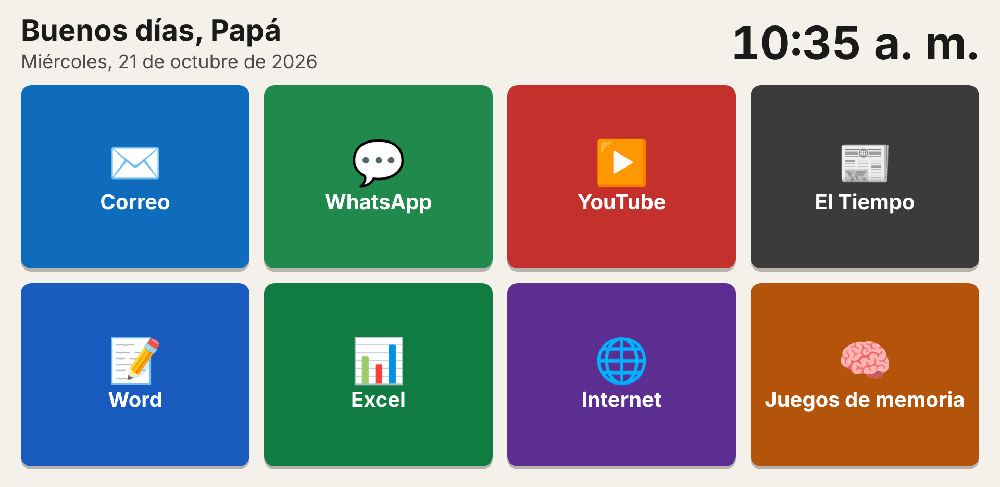

# Inicio: the Home screen

A full-screen Home screen with large tiles, and a bar docked at the top of the screen
that maximized apps never cover. Everything is in Colombian Spanish. This is Phase 1 of
[docs/PLAN.md](../docs/PLAN.md) (section 8).

**The top bar** is always visible:
- **🏠 Inicio**: brings the Home screen back from any app.
- The time, and the date with the part of the day ("de la mañana"). The date hides on
  smaller screens.
- **Más bajo / Más alto**: changes the volume and shows Windows' own volume indicator.
- **Escribir a Javier**: opens a WhatsApp chat with you.

During a full-screen video, the bar steps aside and comes back afterwards.

**On the Home screen:**
- One click opens a tile's app, maximized. "Abriendo…" appears straight away, and
  further clicks are ignored for a few seconds, so nothing opens twice.
- If the app is already open, clicking its tile again **brings that window back**
  instead of opening another copy.
- Alt+F4 doesn't close the Home screen or the bar.
- **Family menu**: hold the clock (top right) for 4 seconds, then type the PIN. From there
  you can reload the configuration or close Inicio.

## Install on Dad's or Mum's PC

1. **Get the installer.** On GitHub: **Actions → "Build Inicio for Windows" → the latest
   green run → Artifacts → Inicio-instalador**. Unzip it to get `Inicio_0.1.0_x64-setup.exe`.
2. **Sign in as Dad (or Mum)** and run the installer there. It installs for that
   account only and doesn't need an admin password.
   - The installer isn't digitally signed, so Windows may say *"Windows protected your
     PC"*. Click **More info → Run anyway**.
   - If **Smart App Control** is *On*, it blocks unsigned programs completely (see
     *Known limitations*).
3. **Create the configuration** (next section).
4. Start **Inicio** from the Start menu. From then on it starts by itself at sign-in.

## Configuration

Inicio reads `%LOCALAPPDATA%\windows4seniors\launcher.json` on the PC. Copy
[`config/papa.json`](../config/papa.json) or [`config/mama.json`](../config/mama.json)
there and edit it in Notepad:

| Field | What to put |
|---|---|
| `name` | The name in the greeting: "Buenos días, **Papá**" |
| `adminPin` | The family menu PIN. **Change it from `0000`** |
| `help.label` | The text on the red Help button |
| `help.whatsappPhone` | **Your** WhatsApp number, digits only, with the country code (57 for Colombia) |
| `tiles` | The tiles, in order. Up to 4 per row |

Each tile has a `label`, an `icon` (an emoji), a `color` and what to `open`:

| `open.type` | Opens | Example |
|---|---|---|
| `web` | A website in its own Chrome window, with no tabs or address bar | `{ "type": "web", "url": "https://www.eltiempo.com" }` |
| `browser` | A website in a normal Chrome window | `{ "type": "browser", "url": "https://www.google.com" }` |
| `app` | A Store or desktop app by its AppID | `{ "type": "app", "id": "Microsoft.OutlookForWindows_8wekyb3d8bbwe!Microsoft.OutlookforWindows" }` |
| `program` | A program registered with Windows | `{ "type": "program", "name": "winword.exe" }` |
| `uri` | A link an app handles | `{ "type": "uri", "uri": "whatsapp:" }` |
| `soon` | Nothing yet: shows "estará listo muy pronto" | `{ "type": "soon" }` |

To find an app's AppID, run `Get-StartApps` in PowerShell and copy the `AppID` column.
**Check the Outlook AppID on the real PC this way.**

The newspaper tile points to *El Tiempo* as an example. Replace it with the papers
they actually read.

After editing, open the family menu and choose **Recargar la configuración**. If the
file is missing or has a mistake, Inicio shows *"Falta la configuración"* with the
exact problem.

## First test on the real PC

These have only been checked in a browser and by the compiler, not yet on Windows:

- [ ] The bar sits at the top, and maximized apps (Word, Chrome) stay **below** it.
- [ ] Each tile opens its app. **Clicking the tile again brings the same window back**
      (try it after minimizing the app).
- [ ] **Inicio** brings the Home screen back from any app.
- [ ] **Más bajo / Más alto** change the volume.
- [ ] **Escribir a Javier** opens your WhatsApp chat.
- [ ] A **full-screen YouTube video** covers the bar, and the bar comes back afterwards.
- [ ] Alt+F4 doesn't close Inicio; the family menu does.
- [ ] After restarting the PC, Inicio starts by itself.

## Known limitations

- **Smart App Control.** If it's *On* on the PC, it blocks Inicio because Inicio isn't
  digitally signed. There are two ways out:
  1. Sign the installer with a code-signing certificate. Azure Trusted Signing costs a
     few dollars a month.
  2. Turn Smart App Control off. That's permanent unless Windows is reinstalled, and you
     lose its protection.

  If it shows *Evaluation*, it may still allow Inicio. Check with
  `Set-MachineSettings.ps1`, which reports its state.
- **Windows taskbar.** It stays visible at the bottom, so he can still open other things
  from it.
- **"Juegos de memoria"** shows "coming soon" until the brain trainer exists (Phase 2).
- **Remote configuration.** The configuration can't be changed remotely yet: edit it
  over Chrome Remote Desktop.

## Development

- `npm install`, then `npm run dev`: the screens in a normal browser at
  http://localhost:5173 (Dad) or http://localhost:5173/?person=mama (Mum). The bar is at
  `/bar.html`. Opening apps is only logged to the console.
- `npx tauri dev` on Windows (needs Rust and Node): the real app.
- Every push to `main` that touches `app/` builds the installer on GitHub Actions.
